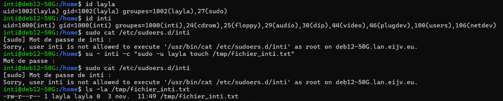
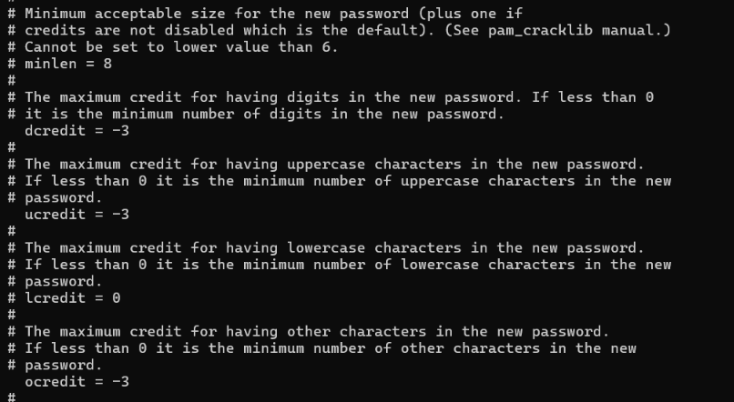
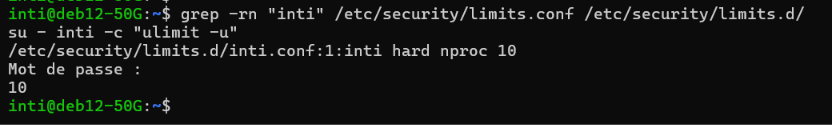
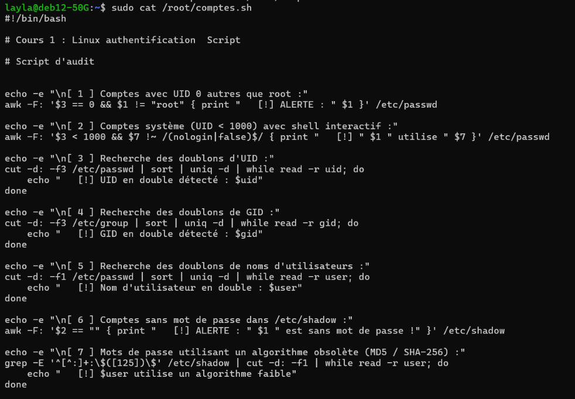
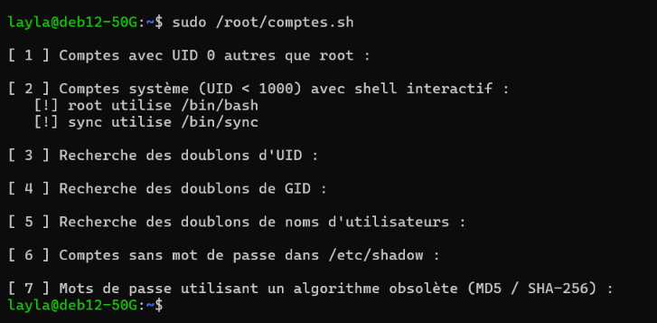

# Writeup TP 1 — Authentification Linux, PAM & Audit des Comptes Système

## Présentation du TP

| Paramètre | Valeur |
| :--- | :--- |
| **Système d'exploitation** | Debian 12 (Bookworm) |
| **Module** | Administration Système & Sécurité Linux — TP 1 |
| **Thématiques** | IAM, Principle of Least Privilege (PoLP), PAM, Shell Scripting |
| **Comptes de test** | Administrateur : `layla` \| Utilisateur restreint : `inti` |

---

## Exercice 1 : Gestion des utilisateurs et élévation de privilèges via `sudo`

### 1. Contexte et objectifs de sécurité
L'objectif est d'appliquer le principe du moindre privilège (Principle of Least Privilege). L'administration système globale est retirée à l'utilisateur `inti` et confiée à un compte dédié `layla`. Une règle `sudoers` stricte est ensuite mise en place pour permettre à `inti` d'exécuter uniquement le binaire `/usr/bin/touch` sous l'identité du compte `layla`.

### 2. Procédure d'exécution

1. **Création du compte d'administration et configuration de l'accès sudo :**
   ```bash
   sudo useradd -m -s /bin/bash layla
   sudo passwd layla
   sudo usermod -aG sudo layla
   ```

2. **Révocation des privilèges sudo de l'utilisateur `inti` :**
   ```bash
   sudo deluser inti sudo
   ```

3. **Création du fichier de règle d'accès granulaire `/etc/sudoers.d/inti` :**
   ```bash
   sudo visudo -f /etc/sudoers.d/inti
   ```
   *Contenu du fichier `/etc/sudoers.d/inti` :*
   ```text
   inti ALL=(layla) NOPASSWD: /usr/bin/touch
   ```

4. **Validation du comportement du système :**
   Connexion sous l'identité `inti` et exécution de la commande autorisée :
   ```bash
   su - inti
   sudo -u layla touch /tmp/fichier_inti.txt
   ```

### 3. Analyse du résultat et vérification des permissions
La vérification de l'élément créé dans `/tmp` confirme l'élévation ciblée :
```bash
ls -la /tmp/fichier_inti.txt
# Output: -rw-r--r-- 1 layla layla 0 Nov 3 11:49 /tmp/fichier_inti.txt
```
L'utilisateur `inti` ne peut exécuter aucune autre commande avec privilèges (`cat`, `ls`, etc. sous `sudo` sont immédiatement rejetés par le contrôle d'accès).

### 4. Preuve d'exécution


---

## Exercice 2 : Politique de complexité des mots de passe (`pam_pwquality`)

### 1. Contexte et objectifs de sécurité
Afin d'éviter la définition de mots de passe faibles vulnérables aux attaques par dictionnaire ou force brute, le module PAM `pam_pwquality` est configuré pour imposer des critères de complexité stricts lors de la modification des mots de passe.

### 2. Installation et configuration
1. **Installation du composant PAM :**
   ```bash
   sudo apt update && sudo apt install -y libpam-pwquality
   ```

2. **Édition du fichier de configuration `/etc/security/pwquality.conf` :**
   ```ini
   # Minimum length constraint
   minlen = 12

   # Credit parameters (negative values enforce a minimum required count)
   dcredit = -3
   ucredit = -3
   ocredit = -3
   ```

### 3. Explication des paramètres techniques
- `minlen = 12` : Définit la longueur minimale requise à 12 caractères.
- `dcredit = -3` : Requis d'au moins **3 chiffres** (`digits`).
- `ucredit = -3` : Requis d'au moins **3 lettres majuscules** (`uppercase`).
- `ocredit = -3` : Requis d'au moins **3 caractères spéciaux / symboles** (`other`).

*Note : En syntaxe `pwquality`, une valeur négative (`-N`) n'accorde pas de bonus de longueur mais rend la présence d'au moins N caractères de cette classe obligatoire.*

### 4. Preuve d'exécution


---

## Exercice 3 : Limitation des ressources système (`limits.conf`)

### 1. Contexte et objectifs de sécurité
La restriction des ressources allouées par utilisateur permet de prémunir le système contre les attaques par déni de service local (ex: Fork Bomb) et l'épuisement de la table des processus du noyau.

### 2. Configuration de la politique de limitation
Création d'un fichier de configuration dédié dans le répertoire `/etc/security/limits.d/inti.conf` :
```text
# Domain    Type    Item    Value
inti        hard    nproc   10
inti        soft    nproc   10
```

- `nproc` : Nombre maximal de processus qu'un utilisateur peut instancier simultanément.
- `soft` : Limite d'avertissement immédiatement active pour la session.
- `hard` : Plafond maximal absolu ne pouvant pas être dépassé par l'utilisateur.

### 3. Vérification de la directive
Exécution du contrôle de limite dans l'environnement de l'utilisateur `inti` :
```bash
su - inti -c "ulimit -u"
# Output: 10
```
Le noyau confirme que l'utilisateur `inti` est strictement restreint à un maximum de 10 processus concurrents.

### 4. Preuve d'exécution


---

## Exercice 4 : Script d'audit de sécurité des comptes système (`/root/comptes.sh`)

### 1. Contexte et spécifications de l'outil
Afin d'automatiser le contrôle d'intégrité des comptes locaux, un script d'audit en Shell Bash a été développé. Il analyse les fichiers `/etc/passwd` et `/etc/shadow` pour détecter d'éventuelles failles de configuration ou des élévations d'accès illégitimes.

### 2. Code source du script (`/root/comptes.sh`)

```bash
#!/bin/bash
# /root/comptes.sh - Script d'audit de sécurité des comptes système Linux

echo -e "\n[ 1 ] Comptes avec UID 0 autres que root :"
awk -F: '$3 == 0 && $1 != "root" { print "   [!] ALERTE : " $1 }' /etc/passwd

echo -e "\n[ 2 ] Comptes système (UID < 1000) avec shell interactif :"
awk -F: '$3 < 1000 && $7 !~ /(nologin|false)$/ { print "   [!] " $1 " utilise " $7 }' /etc/passwd

echo -e "\n[ 3 ] Recherche des doublons d'UID :"
cut -d: -f3 /etc/passwd | sort | uniq -d | while read -r uid; do
    echo "   [!] UID en double détecté : $uid"
done

echo -e "\n[ 4 ] Recherche des doublons de GID :"
cut -d: -f3 /etc/group | sort | uniq -d | while read -r gid; do
    echo "   [!] GID en double détecté : $gid"
done

echo -e "\n[ 5 ] Recherche des doublons de noms d'utilisateurs :"
cut -d: -f1 /etc/passwd | sort | uniq -d | while read -r user; do
    echo "   [!] Nom d'utilisateur en double : $user"
done

echo -e "\n[ 6 ] Comptes sans mot de passe dans /etc/shadow :"
awk -F: '$2 == "" { print "   [!] ALERTE : " $1 " est sans mot de passe !" }' /etc/shadow

echo -e "\n[ 7 ] Mots de passe utilisant un algorithme obsolète (MD5 / SHA-256) :"
grep -E '^[^:]+:\$([125])\$' /etc/shadow | cut -d: -f1 | while read -r user; do
    echo "   [!] $user utilise un algorithme faible"
done
```

### 3. Droits et permissions du script
```bash
sudo chmod 755 /root/comptes.sh
sudo chown root:root /root/comptes.sh
```

### 4. Analyse du rapport d'exécution du script

L'exécution du script en tant que privilège administrateur renvoie les anomalies identifiées :
```text
layla@deb12-50G:~$ sudo /root/comptes.sh

[ 1 ] Comptes avec UID 0 autres que root :

[ 2 ] Comptes système (UID < 1000) avec shell interactif :
   [!] root utilise /bin/bash
   [!] sync utilise /bin/sync

[ 3 ] Recherche des doublons d'UID :

[ 4 ] Recherche des doublons de GID :

[ 5 ] Recherche des doublons de noms d'utilisateurs :

[ 6 ] Comptes sans mot de passe dans /etc/shadow :

[ 7 ] Mots de passe utilisant un algorithme obsolète (MD5 / SHA-256) :
```

*Analyse SecOps :*
- Aucun compte non-root ne possède un UID `0`.
- Deux comptes sous UID 1000 disposent d'un shell d'exécution (`root` et `sync`).
- Aucun doublon d'identifiant (UID/GID/Login) n'a été détecté.
- Aucun mot de passe vierge ni algorithme de hachage obsolète (ex: `$1$` MD5 ou `$5$` SHA-256) n'est présent dans `/etc/shadow`.

### 5. Preuves d'exécution

#### A. Code source du script


#### B. Résultat de l'exécution d'audit

