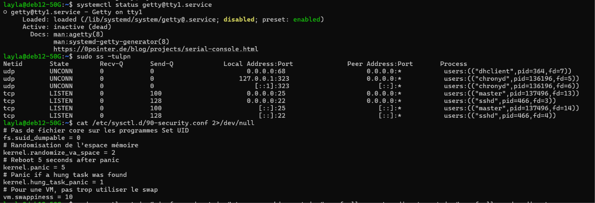
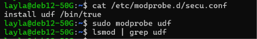

# Writeup TP 2 — Sécurisation & Durcissement Système Linux

## Présentation du TP

| Paramètre | Valeur |
| :--- | :--- |
| **Système d'exploitation** | Debian 12 (Bookworm) |
| **Module** | Sécurité Linux — TP 2 (Sécurisation Système) |
| **Thématiques** | Services Management, Kernel Hardening, Sysctl, Syslog & Audit Logs |
| **Compte Administrateur** | `layla` |

---

## 1. Gestion des services système et audit des ports

### 1.1 Contexte et objectifs
Dans le cadre de la réduction de la surface d'attaque, les services système inutiles doivent être désactivés (notamment les consoles TTY virtuelles inutilisées), et un contrôle strict des sockets d'écoute réseau doit être effectué.

### 1.2 Procédure d'exécution
1. **Désactivation du service `getty@tty1.service` :**
   ```bash
   sudo systemctl disable --now getty@tty1.service
   ```

2. **Vérification du statut du service :**
   ```bash
   systemctl status getty@tty1.service
   ```
   *Résultat :* Le service est marqué comme `disabled` et `inactive (dead)`.

3. **Audit des ports ouverts sur le serveur :**
   ```bash
   sudo ss -tulpn
   ```
   *Analyse :* Le serveur n'expose que les services strictement nécessaires en écoute réseau (SSH sur le port 22/tcp, NTP Chrony sur 323/udp, et Postfix MTA sur 25/tcp en local).

### 1.3 Preuve d'exécution


---

## 2. Hardening du Noyau via `sysctl`

### 2.1 Contexte et objectifs
Le durcissement du noyau Linux via `/etc/sysctl.d/` permet d'activer des protections mémoire (ASLR), de désactiver la génération d'images mémoire (`core dump`) pour les binaires privilégiés, et de prévenir l'épuisement des ressources système.

### 2.2 Configuration appliquée
Création du fichier `/etc/sysctl.d/90-security.conf` :
```ini
# Interdiction des core dumps pour les programmes SetUID
fs.suid_dumpable = 0

# Randomisation de l'espace d'adressage mémoire (ASLR complet)
kernel.randomize_va_space = 2

# Réaction du noyau en cas de panic ou tâches bloquées
kernel.panic = 5
kernel.hung_task_panic = 1

# Réduction de l'usage du fichier d'échange (swap)
vm.swappiness = 10
```

Application des paramètres au noyau :
```bash
sudo sysctl --system
```

---

## 3. Neutralisation des modules noyau non autorisés

### 3.1 Contexte et objectifs
Afin d'éviter le chargement de systèmes de fichiers ou pilotes vulnérables non requis (exemple : le système de fichier UDF), une politique de neutralisation au niveau de `modprobe` est mise en œuvre.

### 3.2 Procédure technique
1. **Vérification initiale du module `udf` :**
   ```bash
   lsmod | grep udf
   ```

2. **Création du fichier d'interdiction `/etc/modprobe.d/secu.conf` :**
   ```text
   install udf /bin/true
   ```

3. **Validation de l'interdiction de chargement :**
   ```bash
   sudo modprobe udf
   lsmod | grep udf
   ```
   *Résultat :* Le module `udf` ne se charge pas dans le noyau. La directive `install udf /bin/true` court-circuite la commande d'insertion du module.

### 3.3 Preuve d'exécution


---

## 4. Synchronisation Temporelle & Centralisation des Logs

### 4.1 Synchronisation NTP avec Chrony
Pour garantir la valeur légale des journaux d'événements et la corrélation des logs d'audit, la synchronisation temporelle est assurée par le démon `chronyd`.

- Configuration du serveur NTP référent (UPJV / `ntp-01.u-picardie.fr`) dans `/etc/chrony/chrony.conf`.
- Vérification des sources de synchronisation :
  ```bash
  chronyc sources
  ```

### 4.2 Interconnexion entre `systemd-journald` et `rsyslog`
Afin d'assurer la persistance et la centralisation des logs système, le journal `systemd-journald` est configuré pour rediriger l'ensemble des flux vers le démon `rsyslog`.

Édition du fichier `/etc/systemd/journald.conf` :
```ini
ForwardToSyslog=yes
```

Redémarrage et validation des services :
```bash
sudo systemctl restart systemd-journald
systemctl is-active rsyslog
```

---

## 5. Analyseur et surveillance des journaux système

### 5.1 Installation et tests de `logcheck` et `logwatch`
- `logcheck` : Analyse automatisée des journaux système à la recherche d'anomalies de sécurité et d'éléments suspects.
- `logwatch` : Génération de synthèses quotidiennes de l'activité système.

### 5.2 Commandes de validation
```bash
# Vérification du bon fonctionnement de logcheck
sudo -u logcheck logcheck -t

# Génération d'un rapport de test logwatch
sudo logwatch --range today --detail low --output stdout
```
