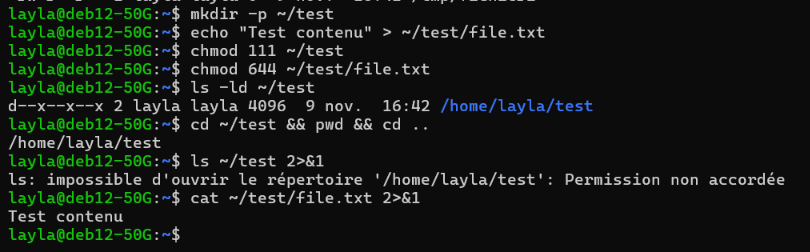
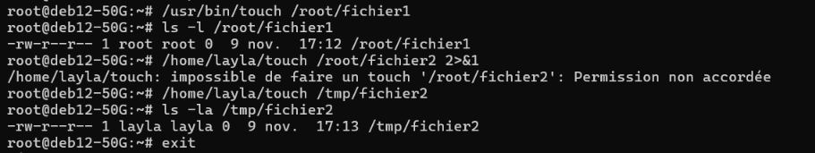
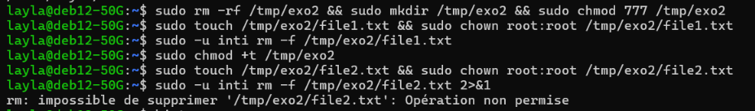
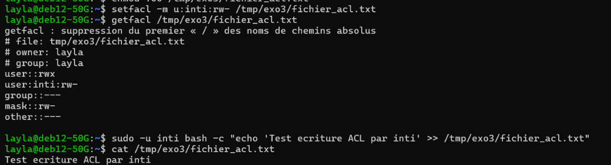
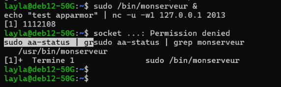

# TP 3 — Control d'Accès POSIX, SUID, Sticky Bit, ACLs & Confinement (AppArmor / SELinux)

## 1. Fiche Synthétique du TP

| Paramètre | Valeur | 
| :--- | :--- | 
| **Systèmes d'exploitation** | Debian 12 (Bookworm) / AlmaLinux 9 (RHEL) | 
| **Module** | Security Hardening — TP 3 : Droits, Permissions & Confinement | 
| **Comptes de test** | Administrateur : `layla` \| Utilisateurs restreints : `inti`, `sam` | 
| **Technologies clés** | POSIX UGO, SUID Bit, Sticky Bit, ACLs POSIX, AppArmor, SELinux | 

---

## 2. Exercice 1 : Permissions de Répertoires & Audits de Sécurité (`find`)

### 2.1 Théorie des droits sur les répertoires Unix
L'accès à un répertoire Linux repose sur la distinction entre le droit de lecture (`r` / octal `4`) et le droit d'exécution/traversée (`x` / octal `1`) :
* **Droit `x` (Execution/Traversée)** : Permet au processus d'accéder aux inodes contenus dans le répertoire si leur nom exact est connu (ex: `cd` ou lecture directe d'un fichier).
* **Droit `r` (Read/Lecture)** : Permet de lister la structure du répertoire (ex: afficher le contenu via `ls`).

### 2.2 Procédure et tests d'accès (`d--x--x--x`)

1. **Création du répertoire et affectation du masque minimal `111`** :
   ```bash
   mkdir -p ~/test
   echo "Test contenu" > ~/test/file.txt
   chmod 111 ~/test
   chmod 644 ~/test/file.txt
   ```

2. **Validation des comportements d'accès** :
   ```bash
   # 1. Traversée du répertoire (Exécution du cd)
   cd ~/test && pwd && cd ..
   # Résultat : /home/layla/test (SUCCÈS - L'exec-bit autorise la traversée)

   # 2. Énumération du contenu du répertoire
   ls ~/test 2>&1
   # Résultat : ls: impossible d'ouvrir le répertoire '/home/layla/test': Permission non accordée

   # 3. Accès direct au fichier connu
   cat ~/test/file.txt 2>&1
   # Résultat : Test contenu (SUCCÈS - Connaissance du chemin + droit 'r' sur le fichier)
   ```

### 2.3 Recherches de sécurité système (`find`)

* **Répertoires inscriptibles par tous (`other` = `w` / octal `0002`)** :
  ```bash
  find / -type d -perm -0002 2>/dev/null
  ```
  *Analyse SecOps :* Ces répertoires représentent un vecteur d'attaque critique (dépôt de charges utiles, attaques par lien symbolique).

* **Fichiers orphelins (sans propriétaire ou groupe valide)** :
  ```bash
  find / \( -nouser -o -nogroup \) 2>/dev/null
  ```
  *Analyse SecOps :* Les fichiers orphelins apparaissent après la suppression de comptes utilisateurs. Ils doivent être réattribués pour éviter qu'un futur UID réutilisé n'en hérite les droits.

### 2.4 Preuve d'exécution


---

## 3. Exercice 2 : Élévation de Privilèges via le Bit SetUID (SUID)

### 3.1 Principe de fonctionnement
Le bit SUID (`chmod u+s` / octal `4000`) force l'exécution d'un binaire sous l'**EUID (Effective User ID)** du propriétaire du fichier, et non sous l'**RUID (Real User ID)** de l'utilisateur qui l'invoque.

### 3.2 Démonstration et restriction d'écriture dans `/root`

1. **Création d'une copie du binaire `touch` avec le bit SUID attribué à `layla`** :
   ```bash
   cp /usr/bin/touch /home/layla/touch
   chmod 4755 /home/layla/touch
   ls -la /home/layla/touch
   # Droits affichés : -rwsr-xr-x 1 layla layla 109616 Nov 9 16:40 /home/layla/touch
   ```

2. **Exécution depuis le compte `root`** :
   ```bash
   # Touch système (exécuté en tant que root)
   /usr/bin/touch /root/fichier1
   # Résultat : Création réussie (propriétaire root:root)

   # Touch SUID de layla (exécuté avec l'EUID de layla)
   /home/layla/touch /root/fichier2 2>&1
   # Résultat : /home/layla/touch: impossible de faire un touch '/root/fichier2': Permission non accordée
   ```
   *Explication SecOps :* Même si la commande est lancée par `root`, le bit SUID force le noyau à exécuter le binaire avec les privilèges de `layla`. L'utilisateur `layla` n'ayant aucun droit dans `/root` (`700`), le VFS refuse l'accès.

3. **Exécution dans `/tmp`** :
   ```bash
   /home/layla/touch /tmp/fichier2
   ls -la /tmp/fichier2
   # Résultat : -rw-r--r-- 1 layla layla 0 Nov 9 17:13 /tmp/fichier2
   ```

4. **Recherche des binaires SUID système** :
   ```bash
   find / -perm -4000 2>/dev/null
   ```

### 3.3 Preuve d'exécution


---

## 4. Exercice 3 : Restriction de Suppression dans les Répertoires Partagés (Sticky Bit)

### 4.1 Modèle de Sécurité
Dans un répertoire partagé en accès global `777` (`drwxrwxrwx`), tout utilisateur peut créer, modifier mais aussi **supprimer n'importe quel fichier**, y compris ceux appartenant à `root`.

Le **Sticky Bit** (`chmod +t` / octal `1777` -> `drwxrwxrwt`) restreint le droit de suppression : seul le propriétaire du fichier, le propriétaire du répertoire ou le compte `root` peut supprimer ou renommer un objet.

### 4.2 Démonstration Comparative

```bash
# 1. Configuration d'un répertoire partagé 777 SANS Sticky Bit
sudo rm -rf /tmp/exo2 && sudo mkdir /tmp/exo2 && sudo chmod 777 /tmp/exo2
sudo touch /tmp/exo2/file1.txt && sudo chown root:root /tmp/exo2/file1.txt

# Suppression du fichier de root par l'utilisateur restreint 'inti'
sudo -u inti rm -f /tmp/exo2/file1.txt
# Résultat : Suppression REUSSIE (le dossier 777 sans sticky bit autorise la suppression)

# 2. Ajout du Sticky Bit (+t)
sudo chmod +t /tmp/exo2
ls -ld /tmp/exo2
# Droits affichés : drwxrwxrwt 2 root root 4096 Nov 9 17:14 /tmp/exo2

# Création d'un nouveau fichier et tentative de suppression par 'inti'
sudo touch /tmp/exo2/file2.txt && sudo chown root:root /tmp/exo2/file2.txt
sudo -u inti rm -f /tmp/exo2/file2.txt 2>&1
# Résultat : rm: impossible de supprimer '/tmp/exo2/file2.txt': Opération non permise
```

### 4.3 Audits système (`find`)
```bash
# Recherche des répertoires avec Sticky Bit (+1000)
find / -type d -perm -1000 2>/dev/null
```

### 4.4 Preuve d'exécution


---

## 5. Exercice 4 : Contrôle d'Accès Granulaire via les ACLs POSIX

### 5.1 Limites du Modèle UGO et Apport des ACLs
Le modèle POSIX standard (User, Group, Other) restreint la gestion des droits à un seul utilisateur et un seul groupe. Les **ACLs POSIX** (`setfacl` / `getfacl`) permettent d'attribuer des permissions nominatives à des utilisateurs tiers sans modifier l'appartenance du fichier.

### 5.2 Mise en œuvre pratique

1. **Création du compte utilisateur `sam`** :
   ```bash
   sudo useradd -m -s /bin/bash sam
   echo "sam:Password123!" | sudo chpasswd
   ```

2. **Création d'un répertoire et d'un fichier verrouillé (`700`)** :
   ```bash
   mkdir -p /tmp/exo3
   touch /tmp/exo3/fichier_acl.txt
   chmod 700 /tmp/exo3/fichier_acl.txt
   ```

3. **Tentative de modification par `sam` (Sans ACL)** :
   ```bash
   sudo -u sam bash -c "echo 'Test sam' >> /tmp/exo3/fichier_acl.txt" 2>&1
   # Résultat : Permission non accordée
   ```

4. **Attribution d'une ACL en écriture/lecture pour `inti` / `sam`** :
   ```bash
   setfacl -m u:inti:rw- /tmp/exo3/fichier_acl.txt
   getfacl /tmp/exo3/fichier_acl.txt
   ```

**Sortie de la commande `getfacl`** :
```text
# file: tmp/exo3/fichier_acl.txt
# owner: layla
# group: layla
user::rwx
user:inti:rw-
group::---
mask::rw-
other::---
```

5. **Validation de l'accès en écriture via l'ACL** :
   ```bash
   sudo -u inti bash -c "echo 'Test ecriture ACL par inti' >> /tmp/exo3/fichier_acl.txt"
   cat /tmp/exo3/fichier_acl.txt
   # Résultat : Test ecriture ACL par inti (SUCCÈS)
   ```

### 5.3 Preuve d'exécution


---

## 6. Exercice 6 : Confinement Applicatif avec AppArmor (Debian 12)

### 6.1 Concept & Architecture
AppArmor est un module de sécurité du noyau Linux (LSM) basé sur les chemins d'accès (*path-based MAC*). Il restreint les capacités système d'un binaire (accès fichiers, création de sockets, privilèges) selon un profil strict.

### 6.2 Code Source du Serveur Echo UDP (`/root/essai.c`)

```c
#include <stdio.h> 
#include <stdlib.h> 
#include <sys/types.h> 
#include <sys/socket.h> 
#include <netinet/in.h> 
#include <netdb.h> 
#include <arpa/inet.h> 
#include <string.h> 
#include <unistd.h>

int main() { 
  int desc,taille,longueur; 
  char chaine[1024]; 
  struct sockaddr_in adr1,adr2; 

  if((desc=socket(AF_INET,SOCK_DGRAM,0)) == -1) { 
    perror("socket ...");exit(1); 
  } 

  adr1.sin_family=AF_INET; 
  adr1.sin_addr.s_addr=htonl(INADDR_ANY); 
  adr1.sin_port=htons(2013); 
 
  longueur=sizeof(struct sockaddr_in); 
  if(bind(desc,(struct sockaddr *)&adr1,longueur)==-1) { 
    perror("bind ...");exit(1); 
  } 

  do { 
    taille=recvfrom(desc, chaine, 1024 , 0, (struct sockaddr *)&adr2,(socklen_t *)&longueur); 
    if (taille > 0) {
        printf("Packet reçu : %s\n",chaine); 
        sendto(desc,chaine,taille,0,(struct sockaddr *)&adr2,longueur); 
    }
  } while(taille>2); 
 
  exit(0); 
} 
```

### 6.3 Déploiement et Profilage AppArmor

```bash
# Compilation du binaire
sudo gcc /root/essai.c -o /bin/monserveur

# 1. Vérification absence de profil
sudo aa-status | grep monserveur

# 2. Mode apprentissage (Complain) & Profilage
sudo aa-complain /bin/monserveur
sudo aa-genprof /bin/monserveur

# 3. Application du profil restreint (Enforce)
sudo aa-enforce /bin/monserveur
```

### 6.4 Preuve de Confinement (Blocage Socket UDP)

Lorsque le profil restreint est actif, toute tentative d'exécution du binaire non autorisée à ouvrir un socket est bloquée immédiatement par le noyau :

```bash
layla@deb12-50G:~$ sudo /bin/monserveur &
[1] 1112084
layla@deb12-50G:~$ socket ...: Permission denied
sudo aa-status | grep monserveur
   /usr/bin/monserveur (enforce)
[1]+  Termine 1               sudo /bin/monserveur
```

### 6.5 Preuve d'exécution


---

## 7. Exercice 7 : Analyse et Contextes SELinux (AlmaLinux / RHEL)

### 7.1 Différences Majeures : AppArmor vs SELinux
Alors qu'AppArmor s'appuie sur la trajectoire des fichiers (*path-based*), **SELinux** utilise un marquage par étiquettes (*label-based MAC* / Type Enforcement). Chaque processus et chaque fichier possède un contexte sous la forme `utilisateur:rôle:type:niveau`.

### 7.2 Analyse de la Problématique HTTPD & SELinux

Sur AlmaLinux, lors de la modification du `DocumentRoot` d'Apache vers `/var/web` :

1. **Renommage de `welcome.conf` & premier `curl`** :
   *Résultat :* Réponse vide ou `403 Forbidden` / `404 Not Found` car aucun document racine n'est configuré et la page par défaut est désactivée.
2. **Création du répertoire `/var/web` & `web.conf` sans directive `<Directory>`** :
   *Résultat :* `403 Forbidden`.  
   *Raison dans `/var/log/httpd/error_log` :* `Client denied by server configuration`. Apache refuse d'accéder au dossier `/var/web` car il manque la clause `<Directory "/var/web">`.
3. **Ajout de la directive `<Directory "/var/web">` & relance du service** :
   *Résultat :* Toujours `403 Forbidden`.

### 7.3 Diagnostic des Logs Audit (`/var/log/audit/audit.log`)
L'analyse des logs montre un blocage AVC (*Access Vector Cache*) :
```text
type=AVC msg=audit(...): avc: denied { read } for pid=1234 comm="httpd" name="index.html" dev="sda1" ino=98765 scontext=system_u:system_r:httpd_t:s0 tcontext=unconfined_u:object_r:var_t:s0 tclass=file permissive=0
```

**Explication SecOps :** Le processus HTTPD s'exécute dans le domaine SELinux `httpd_t`. Le dossier `/var/web` a hérité du contexte par défaut `var_t`. La politique SELinux interdit au domaine `httpd_t` d'accéder aux répertoires qui ne sont pas étiquetés avec le type `httpd_sys_content_t`.

### 7.4 Résolution SELinux (Sans altérer la configuration Apache)

```bash
# 1. Déclarer la règle de contexte SELinux permanente pour /var/web
semanage fcontext -a -t httpd_sys_content_t "/var/web(/.*)?"

# 2. Appliquer les étiquettes sur le système de fichiers
restorecon -R -v /var/web

# 3. Vérifier l'étiquette SELinux attribuée
ls -Z /var/web/index.html
# Résultat affiché : unconfined_u:object_r:httpd_sys_content_t:s0 /var/web/index.html

# 4. Validation d'accès final
curl http://localhost
# Résultat : 200 OK - Contenu HTML restitué avec succès
```
